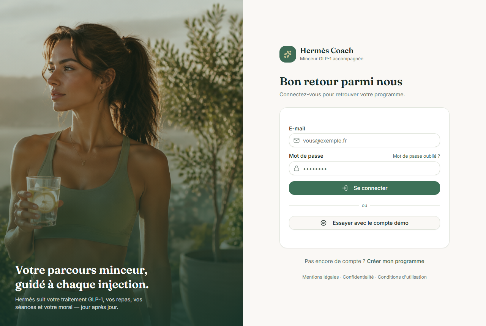

# Hermès Coach — coach santé GLP-1

**▶ App en ligne : [coach.rvlts.com](https://coach.rvlts.com)** — « Essayer avec le compte démo » ouvre l'app complète sans créer de compte.
Par [John Dossin](https://dossin.rvlts.com) · portfolio complet : [dossin.rvlts.com](https://dossin.rvlts.com)

Un coach de suivi de traitement GLP-1 : **web, Android natif, abonnement**, et un **agent IA qui analyse chaque journée** — un sujet sensible traité comme un produit.

> ℹ️ Ce dépôt est une **vitrine** : le code source est privé (données de santé, RGPD art. 9). Accès en lecture sur demande pour un entretien — dossinjohn@gmail.com.

## Décisions d'ingénierie

- **Agent local asynchrone plutôt qu'un appel LLM direct** — chaque analyse est un job (30 s à plusieurs minutes) avec `jobId` et polling : l'app reste réactive, l'agent travaille en file.
- **Webhook d'abonnement fail-closed** (RevenueCat) — si le réseau ou le service ment, l'accès se ferme, jamais l'inverse.
- **Migration react-router 7 → 8 dès la publication de la CVE CSRF (RSC)** — maintenance de sécurité sur du code en production, pas de la dette accumulée.
- **SQLite derrière Express**, sessions révocables, rate-limit, bornage serveur de toutes les entrées numériques — la sécurité comme posture, pas comme correctif.

## Stack

| Couche | Technologies |
|---|---|
| Web | Vite · React 19 · TypeScript strict |
| API | Express 5 · better-sqlite3 · PM2 |
| Mobile | Android Kotlin / Jetpack Compose |
| Services | RevenueCat (abonnement) · bot Telegram |
| Infra | VPS administré par moi · nginx · TLS |

## Testé où ça compte

- **Tests unitaires sur la logique de dosage GLP-1** (app Android) : le choix de quoi tester — le risque patient — plutôt que la couverture.
- **PDF de suivi pour le médecin** et **analyse photo d'étiquettes nutritionnelles** : deux fonctionnalités nées d'un usage réel, pas d'une roadmap.

## Décidé · Délégué · Vérifié

| Décidé (moi) | Délégué (agents IA) | Vérifié (moi) |
|---|---|---|
| Agent asynchrone en file d'attente | Écriture du code | Revue ligne à ligne avant merge |
| Fail-closed sur les paiements | UI React et composants | QA visuelle + tests sur le dosage |
| Migration CVE immédiate | Création de l'app Android | Exploitation quotidienne depuis la mise en prod |
| RGPD art. 9 : données minimales, sessions révocables, actions journalisées | | |
